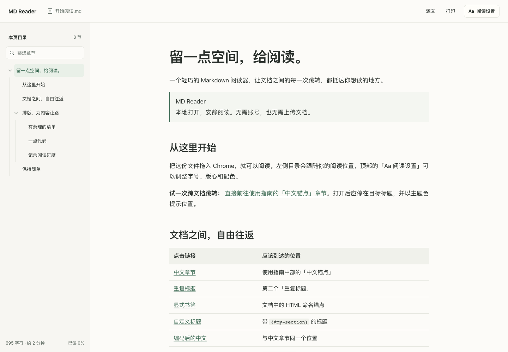

# MD Reader

MD Reader 是一款轻量的 Chrome Markdown 阅读扩展。它在原文件地址上呈现文档。点击 `另一个文件.md#章节` 时，阅读器会等目标文档渲染后再定位到章节。



## 功能

- **跨文件跳转**。支持相对链接、中文标题、重复标题、HTML 锚点和自定义标题 ID。浏览器前进、后退和新标签页照常使用。
- **同文件夹文档**。打开本地文件后，在左侧「文件」标签筛选、刷新和切换同级 Markdown 文档。
- **多级目录**。点击箭头展开或收起下级章节，点击标题跳转。筛选会显示匹配章节及其上级标题。
- **阅读设置**。默认使用纸感绿，可切换标准蓝或自定义主题色。字号、版心和明暗模式可单独调整，明暗默认跟随系统。
- **源文与打印**。支持查看 Markdown 源文，以及通过 Chrome 打印或保存为 PDF。正文支持常见 Markdown 和 GFM 表格、任务列表与代码块。

[查看深色界面和文件列表](docs/folder-dark.png)

## 安装

1. 下载并解压仓库源码，或下载 Releases 中的 `MDReader-1.4.1.zip` 并解压。
2. 在 Chrome 打开 `chrome://extensions`，开启「开发者模式」，点击「加载已解压的扩展程序」。
3. 如果下载的是源码，选择里面的 [`extension/`](extension/) 文件夹。如果下载的是安装包，选择解压后直接包含 `manifest.json` 的文件夹。
4. 打开 MD Reader 的「详情」，启用「允许访问文件网址」。如果已安装其他 Markdown 阅读扩展，可暂停同类扩展，避免同时处理一个页面。

源码中的 `extension/` 已包含构建产物，可以直接加载。更新后，在扩展管理页刷新 MD Reader，再刷新已打开的文档。

## 试用

把 [`examples/开始阅读.md`](examples/开始阅读.md) 拖入 Chrome。点击文中的「中文锚点」链接，会打开 [`使用指南.md`](examples/章节/使用指南.md) 并定位到文档中部。左侧「文件」可切换同级示例，「目录」可展开当前文档的章节。字号、版心和配色位于右上角「阅读设置」。

本地文件支持 `.md`、`.markdown` 和 `.mdown`。在线文件需以纯文本或 Markdown 原文提供，例如 GitHub 的 Raw 文件地址。同文件夹列表仅用于本地文件，显示当前目录中的 Markdown。

## 隐私与权限

Markdown 在浏览器中处理，扩展没有账号、后端或遥测。文档引用的在线图片由浏览器向原站点加载。扩展用 `storage` 保存阅读设置，并在开启文件网址访问后使用 `file:///*` 权限读取当前文档的同级文件列表。

## 从源码构建

构建使用 Node.js 和 pnpm。发布版用 Node.js 24 和 pnpm 11 验证。

```sh
pnpm install --frozen-lockfile
pnpm build
pnpm test
```

运行浏览器回归检查及生成 Chrome 安装 ZIP。打包命令需有 `zip` 可用。

```sh
pnpm exec playwright install chromium
pnpm test:browser
pnpm package
```

`src/` 包含阅读器、目录、导航和本地文件列表逻辑。`extension/` 是 Chrome 扩展加载目录。`examples/` 和 `tests/` 分别放置试用文档和测试。

第三方依赖及许可证见 [Third-party notices](extension/THIRD_PARTY_NOTICES.md)。
